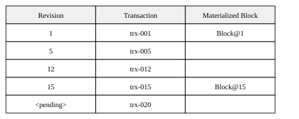

# Block Repository

## Overview

This document outlines the design for a Block Repository that provides efficient access to versioned data. The system manages blocks of data with versioning capabilities, allowing users to retrieve blocks at specific versions, update blocks conditionally, and mark blocks for eventual deletion.

The system provides these core operations through the `IRepo` interface
(`packages/db-core/src/network/i-repo.ts`):
- `get(blockGets[])`: Fetch blocks by their IDs and versions or specific transactions
- `pend(request)`: Post a transaction for a set of blocks
- `cancel(actionRef)`: Cancel a pending transaction
- `commit(request)`: Commit a pending transaction

`getStatus(actionRefs[])` — get statuses of block actions — is *not* on `IRepo`; it lives one layer
up on `ITransactor` (`packages/db-core/src/transactor/transactor.ts`), which is what applications
call. The sections below describe the per-block repo operations.

## Clusters

The Block Repository is designed around peer proximity in the DHT network.  Each peer is responsible for at least transactional (short term) storage of blocks in the address proximity, thus a given Block's storage is distributed across multiple peers (the "cluster").  When performing operations on a cluster, a client will choose a "coordinator" peer, which may be arbitrarily chosen, or chosen based on past performance or ID proximity.  The coordinator is responsible for coordinating the operation across the cluster, for the given transaction.

Here is how a transaction proceeds for a given cluster:
1. The coordinator receives the mutation (e.g. pend, commit, cancel), validates it, puts it in a record with a TTL, signs its own promise on it, then sends it in parallel to all other peers in the cluster.
2. If the coordinator receives a promise from the necessary number of peers, it, in parallel, responds with success to the client, and propagates the record with its own signed completion to the other peers in the cluster. 

* If the coordinator does not receive a promise from the necessary number of peers, before the TTL expires, or it receives failures, is signs as a failure and returns failures to the client.
* If the client looses connection to the coordinator, it can retry with a new coordinator.
* Peers will not sign their promise on a transaction that contradicts a previous transaction until the prior transaction is known to have failed or succeeded.  If a new coordinator is chosen, it will have to confirm consensus on the prior attempt before proceeding.
* If Peers receive invalid requests from other peers, they will whisper with the other peers to exclude the invalid peer from the cluster in the future.

## Repository Operations Description

### 1. `get(blockGets[])`

- **Purpose**: Fetch blocks by their IDs and versions or a specific transaction
- **Input**: Array of `BlockGet` objects containing:
  - `blockId` - A unique identifier for the block
  - `context` - Optional transaction context specifying either a revision or pending transaction
- **Output**: Array of `GetBlockResult` objects containing:
  - `block` - The block data
  - `state` - Current block state including latest revision or deletion status. `state.latest` is
    the newest revision the *answering repo* holds for the block — not necessarily the revision of
    the `block` it just returned
  - `materialized` - Optional; the `(rev, actionId)` the returned `block` actually is. Equals
    `state.latest` for an unpinned read; an older revision when a revision-pinned read serves older
    content. Consumers that need "what revision did this read observe?" (read-dependency recording)
    or must label the content when passing it on (a block-repair archive) use this, falling back to
    `state.latest` only for producers that omit it. One field carrying both halves, so a label can
    never pair one revision's number with another's action id
- **Behavior**: 
  - If no context is provided, returns the latest version
  - If a revision is specified, returns the block at the highest committed revision at or below it
  - If a transaction ID is specified, returns the block with pending changes applied
  - Fails if requesting a deleted block with pending transaction

### 2. `pend(request)`

- **Purpose**: Post a transaction for a set of blocks
- **Input**: `PendRequest` containing:
  - `transform` - The changes to apply
  - `actionId` - Action identifier
  - `pending` - How to handle existing pending transactions
- **Output**: `PendResult` indicating success or failure with pending transaction information
- **Behavior**:
  - Creates metadata for new blocks if needed
  - Can fail if pending='fail' and other transactions are pending
  - Saves block-specific transforms for each affected block

### 3. `cancel(actionRef)`

- **Purpose**: Cancel a pending transaction
- **Input**: `ActionBlocks` containing block IDs and transaction ID
- **Behavior**: Removes the pending transaction from all specified blocks

### 4. `commit(request)`

- **Purpose**: Commit a pending transaction
- **Input**: a single `RepoCommitRequest` object containing:
  - `blockIds` - Blocks covered by this commit
  - `actionId` - Action identifier
  - `rev` - Revision being committed
  - `tailId` - Optional; the committing collection's chain tail block id, threaded through so the
    committing node can anchor the emitted change event
  - `blockDigests` - Optional; per-block declarations of what each block will contain once this
    action commits (see *Declared block content* below)
- **Output**: `CommitResult` indicating success or missing transactions needed
- **Behavior**:
  - Verifies expected revision matches current state
  - Updates block metadata and revision
  - Promotes pending transaction to committed state
  - Handles block deletion if specified in transform

#### Declared block content (`blockDigests`)

The client that authored a transaction knows what every block it touches will contain once the
transaction lands, so it says so: `blockDigests` maps a block id to a hash of that block's
post-commit content, plus the committed revision of the base the hash was computed from (absent for
an inserted block, whose content does not depend on any base). Only the client can declare this — a
coordinator forwards a commit without materializing it, and may not even have seen the pend.

Three properties are load-bearing:

- **It is optional, per block.** The client computes digests from what it already has in memory and
  never pays a network read to describe itself, so a block it cannot describe from memory is simply
  left out. An undeclared block is not an error; it falls back to the corroboration the cohort
  already does. The field is omitted entirely — not sent as an empty object — when a request
  declares nothing.

  What "from memory" covers is a property of the *transaction*, not of the read cache's size. When a
  change to a block is staged, the client pins the committed content it changed it from, and keeps
  that pin until the transaction ends — so a transaction that touches far more blocks than the read
  cache holds still describes every block it read and changed, rather than only the most recently
  read ones. The remaining undeclarable cases are a deletion (there is no post-commit content to
  describe), and a *blind* change — one written without first reading the block — to a block that is
  not in the read cache, where the client genuinely has nothing to describe.
- **It rides *inside* the commit request.** The request is the consensus message, and the cluster
  hash helpers canonicalise that message generically, so the declarations land inside every cohort
  signature's preimage with no change to the hashing. A peer built before this field existed still
  hashes the bytes it received, so upgraded and un-upgraded peers agree on the same hash.
- **Each cohort sees only its own blocks.** One transaction's blocks are split across coordinators,
  and each per-coordinator batch becomes its own cluster record. The transactor therefore narrows
  the map to the batch's own block ids at the moment it sends — not once up front, because a failed
  batch is re-split across different coordinators on retry. Shipping the whole map would make one
  cohort sign for blocks it is not responsible for.

Declaring content must never break committing it. Computing a digest replays the staged changes
against the locally cached base, which can legitimately fail (another action's commit may have
folded a different shape into the cache); that block is then left undeclared rather than raising an
error out of the client's sync.

**Who checks it.** A declaration is worth nothing until someone independently reproduces it. Each
cohort member does that on the commit's *promise* round: it re-materializes the block from the
transform it was handed at pend and votes reject (reason `content-digest-mismatch`) when the result
disagrees. A member that cannot reproduce the answer — it never saw the pend, or it holds a
different base for an update-only block — abstains rather than guessing. See
[internals.md](internals.md) "Commit content-digest check (promise round)" for the full
checkable/abstain rule, and `docs/correctness.md` §2 **Content digest declaration** for what an
approval does and does not attest.

**What `baseRev` does at apply time.** The declared base is not only an input to that vote. When
the commit is applied, a member that holds a base *other* than the one the author computed against
refuses the commit outright rather than applying the author's edits to different bytes — which
would leave it holding different content under the same revision number, permanently. The base the
member compares against comes first from the *pend*: `PendRequest.baseRevs` names, per update-only
block, the committed revision the operations were computed against, and storage keeps it with the
pending record (see *A pending record claims a slot* below). The commit's `baseRev` is the fallback
for a record whose pend named none, and a commit whose declaration disagrees with the stored base is
refused too. So the fork protection no longer depends on declaring content: a block whose pend named
its base is protected whether or not its digest was declared, and only a sender that names no base
anywhere is left unprotected — by choice, so that older builds keep committing. What not declaring
still costs is the replication cost in `docs/correctness.md` §"The cost of not declaring". See
[internals.md](internals.md) "An update-only transform is applied only to the base its author read".

#### Invariant P — a pending record and a committed record never coexist for one action

A block never holds a pending record and a committed record for the same action id at the same
time. On the commit path this holds because promotion *moves* the record from the pending namespace
to the committed one atomically (two entries of one write-ahead-log record on the filesystem backend,
a synchronous two-map swap in memory) rather than copying it.

Every **other** writer of a committed transform for a block must maintain the same invariant by
deleting that action's pending record when it writes the committed one. Today those writers are the
forward-write paths `BlockStorage.saveReplica` (replica persist, e.g. churn re-replication and the
divergence reconcile) and `BlockStorage.saveDeletion` (forward tombstone); both go through
`saveForwardRevision`, which performs the deletion. Any forward path added later inherits the
obligation.

`StorageRepo.pend` carries the mirror-image obligation: it must not *create* the coexistence in the
first place. A re-pend of a block this same action already committed at the requested revision (the
retry of a *torn action* — a write whose blocks committed one group at a time, some landing and the
rest refused) is waved through as **satisfied** and no pending record is written for it. Writing one
would strand it exactly as the paragraph below describes: `commit` partitions that block as
already-done and never promotes the record.

Two mechanisms *enforce* that obligation rather than merely stating it:

- **`pend` classifies and saves under one hold.** It takes the write latches for all of its blocks
  up front (`acquireBlockWriteLatches`, the same sorted, deduped entry point `commit` and
  `applyInvalidation` use), then runs two passes inside that hold: pass 1 reads each block's
  `latest` and decides satisfied / stale / pendable, pass 2 writes the pending records. Because the
  read and the write are one atomic step, no commit can land in between and make a decision from
  pass 1 obsolete. Splitting it into two passes rather than one interleaved loop also means a block
  refused partway through leaves *no* records written for the blocks before it — every refusal path
  returns having written nothing.
- **The storage seam refuses the write outright.** `BlockStorage.savePendingTransaction` takes the
  revision the record claims and throws `PendRevisionTakenError` when the block has already
  committed at or past it. Its question is "could this record ever be promoted?", not "is this our
  own revision?", so one `latest.rev >= rev` comparison covers both unpromotable cases: our own
  already-committed revision (`===`, which `commit` treats as already-done) and a rival's win
  (`>`, which `commit` refuses as stale). A pend that claims no revision (an insert-only pend, with
  no `rev`) names nothing to compare and is unaffected. The refusal costs no extra read — that
  method already reads the block's metadata — and under the hold above it is unreachable from
  `pend`, so a throw means some caller reintroduced a check-then-act split.

The invariant matters because a pending record left beside a committed one can never be promoted:
once the block's `latest` has advanced past the revision the record was pended at, a commit retry
partitions the block as already-done or stale and never revisits it. `pend` then reports that
record as a conflicting action on every later write to the block — under the fail-on-pending policy
the node refuses those writes outright and can only catch up by replication, so it looks healthy
and serves reads while silently contributing nothing to that block's writes.

The commit path itself also drops records that become unpromotable when it abandons a batch. It
does so **only** for divergence failures (this node holds no materializable base for a block, or
never received the pend), because the cluster layer reconciles the whole batch after those and every
block advances past the action. A genuine storage fault keeps the batch's pendings, because that
failure is retried and the retry can still replay them.

#### A pending record claims a slot, and reserves the block until a writer builds on it

A pending record is not a bare "someone is writing this block"; it is a reservation for the
revision its pend asked for. Storage keeps that revision beside `latest` (`BlockMetadata.pendingRevs`
in `packages/db-p2p/src/storage/struct.ts`, written by `BlockStorage.savePendingTransaction` in the
same metadata write that seeds a fresh block, dropped with the record by `deletePendingTransaction`)
and hands it back joined onto the record as a claim (`IBlockStorage.listPendingClaims`, or one
record's claim through `IBlockStorage.pendingClaimOf`). Beside it — written, dropped and swept in
the same metadata writes — storage keeps the **base** each record's update operations were computed
against: the pend's `PendRequest.baseRevs` entry for the block, kept as `BlockMetadata.pendingBases`
and read back as `PendingClaim.baseRev`, so that whatever later applies the record can refuse to
apply it to a different version of the block. A record whose pend named no base for the block (an
inserted or deleted block, or a sender that names none) simply has no entry, as does one written
before the field existed; the maps are siblings rather than one map of tuples so that older
metadata reads without a migration. A third sibling, `BlockMetadata.pendingRuns`, read back as
`PendingClaim.localRun`, says which **run of this node** saved the record, and is written only
when the node applied the pend alone for a writer in its own process — see *A pending record's
lifetime is bounded by its writer* below for the rule it serves. The base is stored as told and never checked at pend time: a
member has no grounds to second-guess the author's claim about its own computation, and a pend-time
refusal on a mismatch would be the wrong tier — a member holding a torn or abandoned higher revision
would veto every honest retry, whereas the same mismatch at commit is one member's refusal that
heals by reconcile (the `NOTE:` at `declaredBaseFor` in `packages/db-p2p/src/storage/pending-claim.ts`).
Both maps live in the metadata rather than in the record because the raw drivers promote a record
by moving its bytes into the committed store unchanged — a rename on the filesystem backend — so
the record's value has to stay a plain transform.

Both rival scans — `StorageRepo.pend` at apply and `ClusterMember.validatePendOperations` at the
promise vote — first set aside any record whose writer is provably gone (`isAbandonedClaim` in
`packages/db-p2p/src/storage/pending-claim.ts`, the rule *A pending record's lifetime is bounded by
its writer* states below), then read every other record through one rule, `isReservationAgainst` in
the same file. A record stops reserving once the incoming writer has
**built on** it, meaning its operations were computed against a version of the block that already
holds the record's change. What the rule is fed decides how precisely it can tell:

- **The requested revision** (every scan). Revisions are allocated per collection and a writer pends
  at one past the collection revision it read, so a record claiming the requested revision **or a
  later one** reserves — a live rival inside its pend-to-commit window, and admitting the pend would
  put two writers in one slot — and a record claiming an **earlier** revision is superseded: the
  collection has moved past its slot, which is taken as having been built on.
- **The declared base** — only at the promise vote, only in a cohort that can reach its promise bar
  without one member (`cohortCanMissAPend`: four members and up at the default 0.75 threshold), and
  only for a record that itself carries a stored base. The incoming pend's base for the block is read
  through `reservationRequestFor`, exactly as storage keeps it (nothing for an inserted or deleted
  block, nothing for a malformed entry). A record claiming a slot **at or below** that base is
  superseded — the writer read the block with that change in it. A record claiming a slot **past**
  the base reserves, however far the requested revision has moved: the writer read the block without
  that change, and admitting it would let its commit apply over the stale base and sweep the record —
  the record's change lost while the log names it. That shape needs a member outside the pend's
  quorum: it never received the record's pend, and serves a handle with no floor for the block one
  change short while the record's data-block commit is still in flight
  (`packages/db-p2p/test/rival-superseded-only-by-a-writer-that-built-on-it.spec.ts`). A cohort that
  needs every member's promise cannot produce it, which is why the base is read only where it can.
- A record with **no** claim on file — pended without a revision, or written before the revision
  was kept — reserves, so an old record can only refuse more than it should, never less.

The base arm is never more permissive than the revision arm (an honest base is below the revision
it pends at), so it only ever holds more. Superseding was introduced for
`a-member-that-missed-a-commit-refuses-every-later-write`: a member that promised a write and missed
its commit kept the record, nothing would ever remove it (its writer believed the write succeeded,
and it had), and the member vetoed every later write to the block, from every writer, until it
happened to read the block itself. The base arm keeps that fix: a writer that read the block from a
member holding the change declares at least that revision, and one served by the missed-commit
member itself is served after that member promotes the record (`StorageRepo.get` promotes a held
record for any action the reader's context names, when the record's stored base is the member's
latest). The member comes current when the admitted pend's own commit applies — through
`StorageRepo.internalCommit`, or through the behind-reconcile its fork guard triggers.

Holding more costs liveness, never safety, in two shapes recorded at `isReservationAgainst`, and the
narrowing above exists to keep both off two- and three-member cohorts, where one member's hold sinks
a pend: a writer that read the block one change short is held until the record's action commits,
and today its retries do not re-read the block, so it then re-pends on the stale base and its commit
is refused (backlog `bug-a-writer-held-by-a-change-it-never-saw-retries-on-its-stale-copy`); and a
record whose change no member will ever take — an abandoned action's, on a block no later write
touched — is no longer superseded by the collection moving on where it stands on enough members to
deny a super-majority, and holds the block until its lease runs out (the next section). A copy on one
member alone is outvoted, and because the apply-time scan keeps the revision rule, that member still
stores the admitted pend, whose commit sweeps the record. A record with no stored base — the release
wrote slots without bases — keeps the revision rule, so a node upgraded over its own leftovers does
not wedge on them.

The commit vote checks the base from the other side: a member whose record for the action carries a
base other than the one the commit declares for the block (`blockDigests[id].baseRev`), while its own
latest is that declared base, votes reject with `base-declaration-disagrees`
(`ClusterMember.validateCommitBaseDeclarations`), one round before `StorageRepo.internalCommit` would
refuse the same commit at apply. A member that is not at the declared base abstains — that is the
shape an honest retry meets on a member still holding the earlier attempt's record — and leaves the
refusal to its own apply.

A record claiming a revision the block has **already reached** can never be promoted here at all
(promotion needs `latest.rev < rev`, and `latest` only advances), so every path that advances
`latest` sweeps such records and their claims under the block's write latch
(`BlockStorage.sweepDeadClaims`, from `setLatest`, `recover` and `saveForwardRevision`): the loser
of a same-slot race whose cancel never arrived, and the missed commit above once the block moves past
it — including a replica landing under a *different* action, the reconcile shape that used to leave
the missed action's record standing forever. The committing action's own claim is dropped by `setLatest`
with no delete, since promotion already moved its record; `recover` still deletes each recovered action's
record, since a retry may have re-pended it while the lost `setLatest` was owed. A record with no claim on file is never swept, because
its death cannot be proved. That is the locally decidable half: a record whose slot the block has
not reached and whose writer never came back is not removed by it, and is bounded instead by the
lease the next section states.

#### A pending record's lifetime is bounded by its writer

Invariant P constrains which states may coexist on a member; this sibling rule constrains how long
the pending state may outlive the transaction that created it. It has two halves, and they are
different kinds of claim. Which things REMOVE a record is the writer's business, and the list is
closed. How long a record RESERVES its block is a separate question with a separate answer — a
bounded span measured from the moment this node stored it — and the two are independent: a record
that has stopped reserving is still on file, and its own commit still promotes it. Removal first.

Only five things ever remove a pending record: the client's `cancel` (routed through consensus, so every member drops it), a
divergence-shaped commit refusal (`StorageRepo.dropUnpromotablePendings`), a forward write
carrying the *same* action id (`BlockStorage.saveForwardRevision`'s same-action delete), the
dead-claim sweep that runs whenever `latest` advances to or past the revision a record claims
(`BlockStorage.sweepDeadClaims`, the section above), and the abandonment judgement the next pend
of the block makes about a record whose **writer is provably gone**. That last one fires only when
three facts hold, all of which the node recorded when it saved the record: the node applied the
pend **alone**, with no consensus (`CoordinatorRepo.pendSolo`, the one path that hands the writer's
options through to storage); the writer was running in the node's **own process**
(`MessageOptions.localWriter` in `packages/db-core/src/network/i-repo.ts`, set by
`NetworkTransactor.pend` and `pendMany` on a pend sent to the transactor's own `localPeerId`, and
never put on the wire, so a remote writer cannot claim it — the Quereus plugin's `local` transactor, which writes to a `StorageRepo` in its own process with no node at all, sets the same mark on every pend); and the record was saved in an
**earlier run** of the node (`StorageRepo.runId`, which is `PROCESS_RUN_ID` in
`packages/db-p2p/src/storage/storage-repo.ts`: one random id per process, so every repo a process
builds belongs to one run and a run ends exactly when the process does — and stamped beside the record's slot as
`BlockMetadata.pendingRuns`). A record carrying a stamp from another run is abandoned
(`isAbandonedClaim`): its writer was a transactor in a process of this node that no longer exists,
and nothing else could ever commit or cancel it. `StorageRepo.pend` sets such records aside ahead
of the slot rule (logged `pend:abandoned-claim`), deletes each one under the same latch hold in
which it judged them, before saving the newcomer's record for that block — so a concurrent re-pend
of the same action, which would overwrite the stamp with the current run, is either seen by the
judgement or lands after the delete — and proceeds; `ClusterMember.reservingRivals` skips them at
the vote the same way (logged `cluster-member:validation-pending-abandoned`), and the record is
deleted when the approved pend applies. The mark is positive on purpose: a path that forgets it
leaves the record standing, as every record stood before the mark existed, whereas a forgotten
negative mark would have a live remote writer's record judged dead. There is no background sweep,
and the sweep and the judgement only ever remove a record whose promotion has become impossible. So
the writer that pends a block owns its record's fate: when
`NetworkTransactor.commit` returns, every block in the request must be either **committed** or have
had its pending record **cancelled** — a client that reports success while walking away from a
pended block strands the record permanently, and the members then reject every later write to that
block from any writer (the wedge described two paragraphs up). The one path that violated this — a
non-tail sweep whose transport failed after the tail committed, on the two-step path
`NetworkTransactor.commit` takes when an action's blocks need more than one coordinator or its
one-round commit threw — now cancels the abandoned blocks before acknowledging.

The cancel that discharges a record is a **checked, retried** operation, not a single best-effort
shot. `NetworkTransactor.cancel` runs rounds until every block of the action has had its cancel
answered by some peer, re-resolving coordinators each round and backing off between them, and it
**throws** — naming the action and the blocks still held — if it runs out of budget having reached
nobody. The retry is what distinguishes the two faults that used to look identical from the client:
the peer-shaped one, where an alternate coordinator answers immediately (already handled by the
batch layer's own retry), and the time-shaped one — a stream reset — where every peer is equally
unreachable for the length of the fault and only a delayed re-attempt clears it. Checking matters
just as much as retrying: the batch layer records each RPC's outcome and swallows the rejection, so
without an explicit completeness test a cancel that reached nobody returns exactly like one that
discharged everything, and every caller reads "returned" as "discharged". The same discipline
applies to the cancel a failed pend issues for itself: it is awaited before the pend reports
failure, so a caller that retries immediately does not meet its own still-standing record and spend
an attempt on it.

Callers must not let that throw displace the verdict it is cleaning up after: a confirmed conflict
is still returned as a stale failure so the writer rebases, and a transport fault is still the error
thrown — the cancel failure rides along beside it.

A cancel that runs out of budget is **kept, not forgotten**. Every cancel is itself a cluster
transaction, so the member whose silence sank a write's commit sinks the cancel too — at three
members the promise bar is all three — and no budget is long enough to outlast a member that is
simply off. The writer's transactor keeps the blocks the cancel left unanswered (`OwedCancels` in
`packages/db-core/src/transactor/owed-cancels.ts`, recorded by `NetworkTransactor.dischargeCancel`
before it throws, so no caller has to remember to) and re-sends that cancel before its own next pend
of any of those blocks and on a backoff timer, for the transactor's life; the timer is what frees
other writers, whom the records refuse too, without this writer writing the block again. Re-sending
late is safe whenever it arrives, because a cancel deletes only its own action's pending records and
never moves a revision, so it commutes with every other action — except a re-pend of the *same*
action id, whose fresh record a late cancel would delete. So a pend of an owed action supersedes the
owed cancel for every block it names and waits out any re-send already in flight. Only a writer that
exits, or stops its transactor (`NetworkTransactor.stop`, which the Quereus plugin's
`CollectionFactory.shutdown` calls before it stops its nodes), while a cancel is owed still strands
the record — and on a **one-machine group** the strand no longer wedges anything: a process that
exits before `node.stop()` resolves, with a write between its pend and its commit, leaves a record
the next run judges abandoned and drops on the next write to the block (GitHub #54, pinned by
`packages/db-p2p/test/an-interrupted-write-does-not-wedge-the-collection.spec.ts`). On a larger
cohort the same exit still strands the RECORD on the other members, since a coordinated write's
records carry no stamp, and a remote writer's record through any node is never stamped. What it no
longer strands is the BLOCK, which is the second half of the rule.

**A record reserves its block only for a bounded span.** The span runs from the moment this node
stored the record, which it writes down beside the record's slot (`BlockMetadata.pendingSince`, read
back as `PendingClaim.pendingSince`). Past that span the record has **lapsed**: it no longer reserves
the block against any other writer, at either rival scan. It is **not deleted**, and its own commit
is still honoured — both halves of that sentence are load-bearing, and the rule is `hasLapsed` in
`packages/db-p2p/src/storage/pending-claim.ts`. The span is `StorageRepoOptions.pendLeaseMs`
(`DEFAULT_PEND_LEASE_MS`, five minutes; a node derives its own as ten times the budget its declared
link round trip gives one transactor operation, so a slow-link deployment gets a proportionally
longer lease), and `0` turns lapsing off entirely.

An age bound is what is left once the cheaper signals are spent. The block-passed-the-slot test
(`sweepDeadClaims`), the request-passed-the-slot test (`isReservationAgainst`) and the
provably-dead-writer test (`isAbandonedClaim`) are all in, and what none of them reaches — by
construction — is a record whose slot the collection has not moved past, carrying no in-process
mark: a coordinated write's record, a remote writer's record pended through this node, a record whose
owed cancel a restart forgot, or a record written by a build that kept no claim at all. No comparison
of revisions can retire any of those. The alternative — a cancel driven by a writer-liveness protocol
— needs a writer identity that survives the writer's own restart and a reachable writer, which the
deployments that reported this (phones behind circuit relays) cannot promise.

Lapsing is safe where deleting is not, and that asymmetry is why a merely generous bound is good
enough. Deleting a record whose write is still in flight makes that write's commit fail with a
missing-pend error, which the cluster layer reads as this node having diverged and repairs by copying
the whole block from a peer — more expensive than the leak. Lapsing destroys nothing, so a lease that
fires too early costs only the reservation: another writer is admitted, and one of the two writes is
then refused as stale and retried, the ordinary lost race. The full case analysis is in
[correctness.md](correctness.md) Theorem 1 Case 2, which this does not weaken.

The lease is read exactly where a record is asked to RESERVE — `StorageRepo.pendUnderLatches` pass 1
(logged `pend:lapsed-claim`), `ClusterMember.reservingRivals` at the promise vote (logged
`cluster-member:validation-pending-lapsed`), and `CoordinatorRepo.pendingClaimsOf`, so the
diagnostic enrichment behind a `held` answer never names a holder this node has stopped holding the
block for. Unlike an abandoned record, a lapsed one is **not** added to the pend's delete list. It is
deliberately NOT read where a record is APPLIED or checked: not by
`ClusterMember.validateCommitBaseDeclarations`, not by the read-driven promotion in
`StorageRepo.get`, not by `StorageRepo.internalCommit`'s fork guard. No commit is refused for having
lapsed. Both scans ask abandoned, then lapsed, then slot, in that order, so a record that is both
abandoned and lapsed is deleted rather than merely set aside.

No consensus round decides a lapse, and members may disagree for a moment. Nothing is destroyed, so
no member removes state another is relying on; the verdict is monotone in local time and permanent
once reached, and each member anchors it to its OWN receipt of the same record — nothing ever
compares one node's clock with another's — so members reach it within the pend's own propagation
spread of each other, milliseconds, not within clock skew. While they do differ, a member that has
not yet lapsed the record votes `held`, which a cohort of four or more absorbs (`cohortCanMissAPend`)
and which a cohort of two or three resolves on the writer's next retry. A node whose wall clock steps
backwards delays every lapse, which is safe; one that steps forwards lapses early, which costs a lost
race.

Two things the lease deliberately does not do. It does not reclaim the record's **bytes**: a block
that is never written again keeps them until something else resolves the slot, the accepted cost of
never destroying state on a presumption. And it does not bound a writer that keeps **re-pending** the
same action, since a re-pend overwrites the claim and restarts the lease — correct, because such a
writer is demonstrably alive, but it means a hostile or looping writer can hold a block indefinitely,
as it could before the lease. That belongs to the dispute subsystem. The whole rule is reproduced
end to end by `packages/db-p2p/test/a-lapsed-pend-stops-reserving-its-block.spec.ts`.

A stranded record is at least **named** rather than left to be re-derived. Every refusal it causes is
reported as an ordinary optimistic-concurrency loss, because that is what a single refusal is
indistinguishable from — so a permanently wedged block's logs read exactly like a busy block's. What
no healthy reservation produces is *repetition against an unchanged holder*: a healthy holder keeps
the block only for its own pend-to-commit window, so at most (concurrent writers − 1) distinct actions
can lose to it before it releases. `coordinator-repo:stuck-reservation` (`noteStuckReservation` in
`packages/db-p2p/src/repo/coordinator-repo.ts`) says the condition out loud once per episode, when one
unchanged holding action has refused eight *distinct* later actions on a block — distinct actions, not
refusals, since a retrying writer reuses one action id (minted once per sync cycle in `syncInternal`,
`packages/db-core/src/collection/collection.ts`). The line carries the block id, the holding action
ids, the count, and prose naming what clears the hold: a cancel for that action id, that action's own
commit, the abandonment judgement on a one-machine group, and — failing all of those — the record's
own lease running out, so the wedge the line reports is bounded rather than permanent. The line is
still worth saying: it fires while a lease is running, and a holder that keeps re-pending renews its
lease, so a recurrence past one lease names a *live* holder. The counting, threshold and wording live
in `StuckReservationTracker`
(`packages/db-p2p/src/repo/stuck-reservation.ts`), and every member keeps its own instance too, fed
by its own `held` votes (`cluster-member:stuck-reservation`, from `ClusterMember.validatePendOperations`):
the coordinator can only name a holder its own storage corroborates, so a reservation only some
members hold is named by those members, where the record lives. Like every diagnostic in this
package both go to the `debug` logger, so a node that may need them has to be running with
`DEBUG='optimystic:db-p2p:coordinator-repo*,optimystic:db-p2p:cluster-member'` — see
[debugging.md](debugging.md). It is a diagnosis only — nothing refuses or deletes a record on the
strength of it; the bound that does arrive is measured against the record's own age under the block
latch, not against this counter. What reaches either counter since the section above is the
*same-slot* residue only, for as long as its lease runs: a record claiming a slot the collection has
already moved past no longer refuses at all.

## Block Storage Repository

Block Storage Repository nodes maintain the following state information:
- Latest revision number
- Deletion status (if applicable)
- Pending transactions
- Materialized versions at specific revisions

The system uses a materialization strategy where:
- Blocks can be materialized at any revision by applying transforms sequentially
- Materialized versions are cached to improve performance
- Pending transactions can be applied on top of any materialized version

## Transaction Processing

Transactions go through the following lifecycle:
1. **Pending**: Posted via `pend()` but not yet committed
2. **Committed**: Applied to blocks and assigned a revision number
3. **Materialized**: Full block state computed and cached at specific revisions

The system supports:
- Optimistic concurrency through revision checking
- Transaction conflict detection
- Block restoration through callback mechanism
- Materialization caching for performance

## Block Lifecycle

* **Creation**: Blocks are created through insert transforms
* **Updates**: Applied through pending and committed transactions
* **Deletion**: Marked via delete transform, maintaining revision history

Revisions within a block also have a lifecycle:
* **Checkpoint materialization**: Each committed revision keeps its forward *transform* (the delta that
  produced it) forever, but a full *materialized* copy of the block is retained only at **checkpoint**
  revisions — every `CHECKPOINT_INTERVAL`th rev (default 32), plus the block's tip and the floor of each
  contiguous locally-held range. Redundant intermediate materializations are pruned incrementally as new
  commits land (under the block's write latch, no separate background pass): each commit deletes the
  now-superseded prior materialization unless that rev must be retained. Because every transform is kept
  and a materialization survives at each range floor + checkpoints, **every locally-held revision is still
  reconstructible** by replaying the forward transforms from the nearest retained materialization at or
  below it (replay depth bounded by `CHECKPOINT_INTERVAL`). This keeps storage growth O(revisions × delta
  size) instead of O(revisions × block size). Since no transform is dropped, `meta.ranges` is **unchanged**
  by sweeping — a swept rev is still honestly claimed as present. Pruning the *transforms* of cold ranges
  (which would fragment `ranges` and require restoration) is future work — see the cold-range transform
  offload backlog item.
* **Restoration**: Previous versions can be restored from archival storage as needed

## Implementation Notes

The system is implemented with these key components:
- `StorageRepo`: Main implementation of the repository operations
- `IBlockStorage`: Interface for block storage operations
- `RestoreCallback`: Optional mechanism for block restoration
- `withReadCache`: the single seam that puts the write-through read cache in front of a
  persistent raw storage. `StorageRepo` builds a fresh `BlockStorage` per block per call and
  `BlockStorage` re-reads block metadata on essentially every operation, so nothing above the
  raw-storage boundary memoizes — over a filesystem backend that is hundreds of reads of the same
  small files per statement. Why the cache is safe to read from (and the single-process-owner
  precondition it depends on) is argued in
  [`packages/db-p2p/docs/storage.md`](../packages/db-p2p/docs/storage.md) — see **Invariants** 1-5
  and **Core Components § 6, Write-through raw-storage cache**.

The storage layer maintains separate stores for:
- Block metadata (e.g. latest revision, deletion status)
- Revisions
- Transactions (both pending and committed)
- Materialized block versions

### Capacity estimation and staleness

`StorageAccount.capacity` reports how much of its allotment the node has used
([db-p2p storage.md §9](../packages/db-p2p/docs/storage.md)). Used bytes come from the backend's
`getApproximateBytesUsed`, which is a **full-store scan** (LevelDB iterates every key+value, the
filesystem adapter stats the whole tree). Ring selection calls `capacity` several times per
operation, so the scan is memoized behind a short TTL (`storageAllotment.usedBytesCacheTtlMs`,
default 60s; `0` disables it). Within the window callers share the cached value, and concurrent
misses share a single in-flight scan. Used bytes also include the node's blob piece store's own
figure, read in the same scan, unless `blockStoreCountsPieces` in
`packages/db-p2p/src/storage/store-coverage.ts` says the block store already measured it
([blobs.md §The local store](blobs.md#the-local-store)). The location's free space is read in that
same scan, so the use and the room left can never come from different moments.

Consequence: the reported `usedBytes`/`availableBytes`, and the used fraction ring selection derives
from them, may lag reality by up to the TTL. This
staleness is acceptable — the sole consumer, ring selection (`RingSelector`), damps its move
triggers with EWMA smoothing, a hysteresis dead-band, and a 10-minute minimum dwell. A ≤60s-stale
reading cannot cause a wrong or premature ring move; at worst it delays one by up to the TTL, which
is immaterial against the 10-minute dwell. **`RingSelector` therefore needs no forced-fresh read at
decision boundaries** — the cached estimate is authoritative for its purposes.

- NOTE (tripwire): the default TTL (60s) equals the ring monitor tick interval (the `setInterval` in
  `libp2p-node-base.ts`, also 60s), so each `shouldTransition` tick folds a roughly-fresh sample into
  its EWMA. If `usedBytesCacheTtlMs` is ever raised *above* the tick interval, consecutive ticks would
  fold the *same* cached (stale) sample into the EWMA, biasing the smoothed depth toward the stale
  value. Damping (dead-band + 10-min dwell) absorbs this today; only revisit if the TTL is raised past
  the tick interval or the tick is shortened below the TTL.
